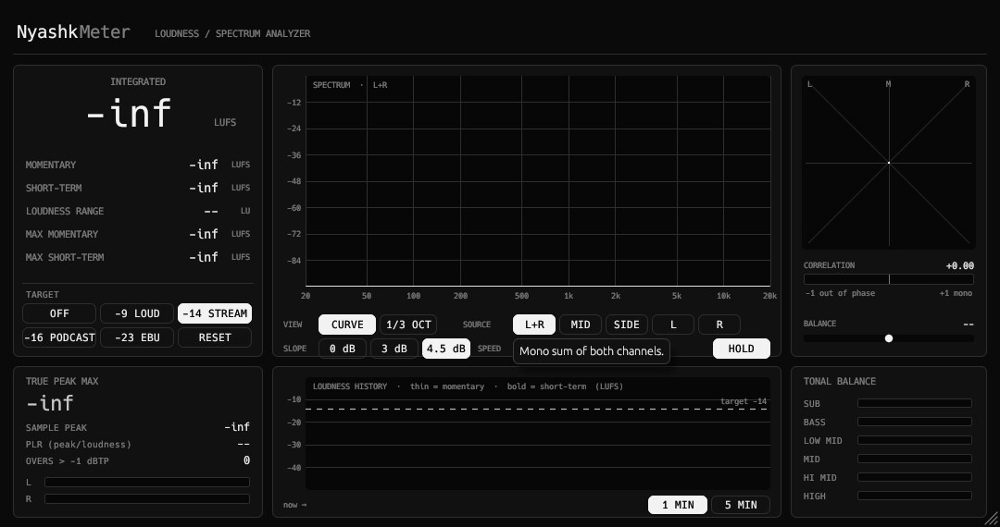

<div align="center">

# NyashkMeter

Master-bus loudness (LUFS, LRA, true peak) and spectrum analyser VST3 plugin with stereo and tonal balance.

[](https://github.com/xslimakx/NyashkMeter/actions/workflows/build.yml)
[](LICENSE)


[**Download**](https://github.com/xslimakx/NyashkMeter/releases/latest)

</div>

<p align="center"></p>

## Install
Use the Nyashk Launcher, or unzip the `.vst3` bundle from the latest release into your VST3 folder.

## Build
```
cargo xtask bundle -p nyashkmeter --release
```
The bundle appears in `target/bundled/`.

## License
MIT
